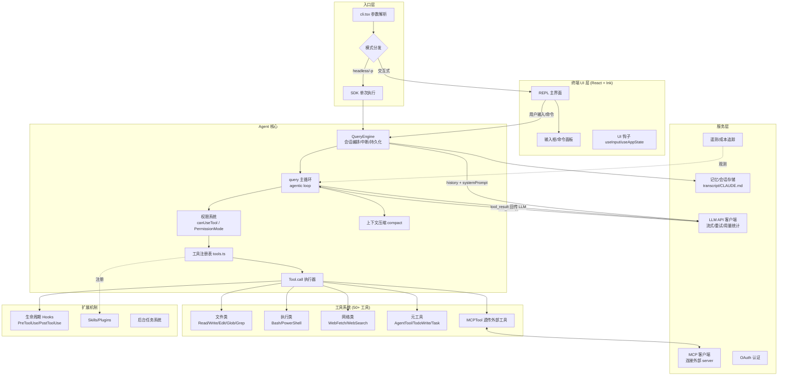
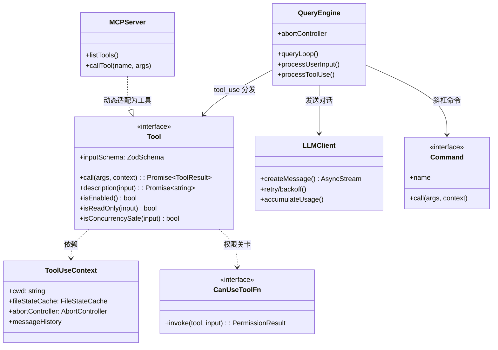
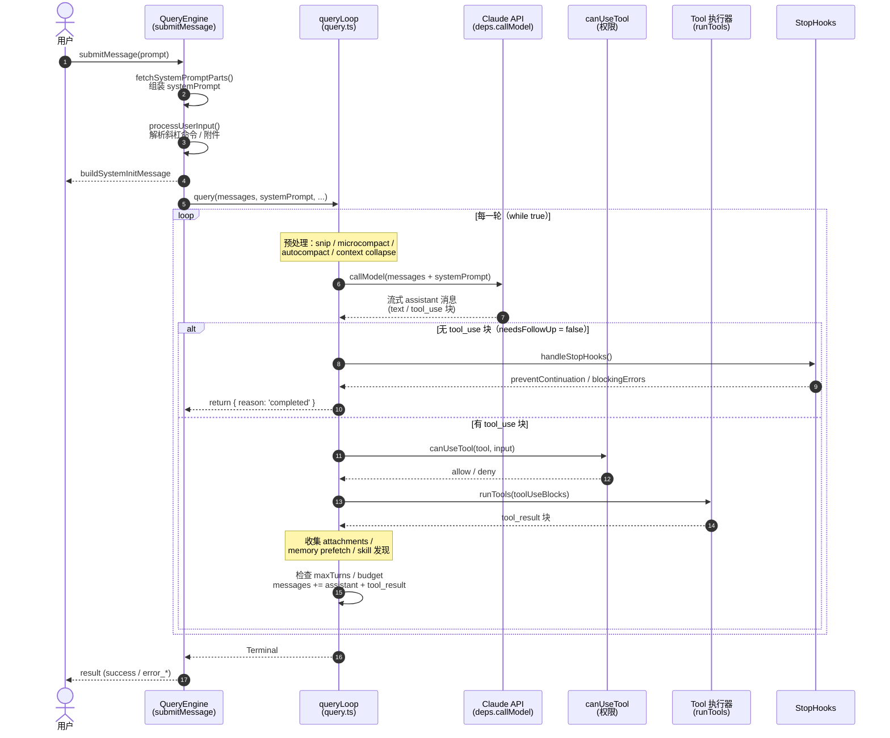

# not_clawd_code

`not_clawd_code` is a reconstructed local build of the publicly exposed Claude Code source snapshot from March 31, 2026. The original public leak exposed an incomplete `src/` tree. This repository was later rebuilt into a runnable Bun project by restoring missing root files, adding compatibility shims, reconstructing missing source/runtime pieces, and patching runtime gaps.

This is not an official Anthropic release.

## Current Status

The current local tree is able to start the interactive CLI again.

Verified in this workspace:

```bash
bun install
bun run version
bun run dev
bun run build
```

Current package metadata:

- `name`: `not_clawd_code`
- `version`: `1.0.24`
- `packageManager`: `bun@1.3.5`
- `engines.bun`: `>=1.1.0`

Verified local Bun version:

- `bun 1.3.11`

Interactive proof:


## What Was Reconstructed

The leaked source snapshot was not originally a complete runnable repository. This working tree now includes:

- restored root build files such as `package.json`, `tsconfig.json`, `bunfig.toml`, `bun.lock`, and `scripts/`
- reconstructed source/runtime pieces needed to complete the partial snapshot
- local compatibility packages under `shims/` for internal or unavailable modules
- extra runtime/vendor material under `vendor/`
- compatibility patches needed to make the interactive CLI start again under Bun

As checked in this workspace:

- `src/` currently contains `2047` files
- `node_modules` is symlinked to `/home/jovyan/shared/claude-code-build/node_modules`
- `dist` is symlinked to `/home/jovyan/shared/claude-code-build/dist`

## Project Structure

Current top-level layout in this reconstructed tree:

```text
.
├── src/                   # Restored TypeScript source tree
├── scripts/               # Build, packaging, install, and test helpers
├── shims/                 # Local compatibility packages for missing/internal modules
├── vendor/                # Native/runtime support sources
├── media/                 # Local media assets
├── package.json           # Package metadata and scripts
├── bun.lock               # Bun lockfile
├── bunfig.toml            # Bun preload configuration
├── tsconfig.json          # TypeScript config
```

Important source areas:

```text
src/
├── entrypoints/           # CLI bootstraps and SDK entrypoints
├── main.tsx               # Main CLI setup path
├── dev-entry.ts           # Reconstructed interactive dev launcher
├── QueryEngine.ts         # Core query/runtime loop
├── commands/              # Slash command implementations
├── tools/                 # Tool implementations
├── components/            # React + Ink terminal UI
├── services/              # Auth, MCP, telemetry, config, compact, etc.
├── bridge/                # IDE / remote-control bridge logic
├── coordinator/           # Multi-agent orchestration
├── tasks/                 # Task system
├── skills/                # Bundled skill logic
├── plugins/               # Plugin support
├── server/                # Server-side / IDE service entrypoints
├── remote/                # Remote session features
├── memdir/                # Persistent memory features
├── keybindings/           # Keyboard handling
├── vim/                   # Vim mode
├── ink/                   # Ink renderer integration
├── utils/                 # Shared helpers
└── types/                 # Shared types
```

## Toolchain And Runtime

This repo is a Bun-first TypeScript CLI project.

- entrypoint: `src/entrypoints/cli.tsx`
- interactive dev entry: `src/dev-entry.ts`
- Bun preload config: `bunfig.toml` preloads `scripts/bun-plugin-shims.ts`
- build output: `dist/cli.mjs`

Important runtime pieces in the current reconstruction:

- `react ^19.0.0`
- `react-reconciler ^0.33.0`
- `ink ^6.8.0`
- local file dependencies for internal modules such as:
  - `@ant/claude-for-chrome-mcp`
  - `@ant/computer-use-input`
  - `@ant/computer-use-mcp`
  - `@ant/computer-use-swift`
  - `color-diff-napi`
  - `modifiers-napi`
  - `url-handler-napi`

## Install And Run

From the repo root:

```bash
bun install
bun run version
bun run dev
```

Other useful commands:

```bash
bun run build
bun run start
bun run check
bun run test
```

In this workspace there is also an external helper launcher:

```bash
not-claude
```

That launcher is only a convenience wrapper around this repo. The repo-native command is still:

```bash
bun run dev
```

## Research Context

This repository exists for educational use, defensive security research, software supply-chain analysis, and architecture study. It should not be treated as an official Anthropic repository or an authoritative release artifact.

The current local state is a reconstruction. It is usable, but it may still differ from Anthropic's original internal repository in structure, history, packaging, and exact runtime behavior.

## Maintainer

- Yaswanth-ampolu
- `ampoluyaswanth2002@gmail.com`

# architecture






## System Prompt（系统提示词）

系统提示词由 `src/constants/prompts.ts` 中的 `getSystemPrompt()` 生成，返回 `Promise<string[]>` —— 数组每一项是一个提示词块，最终拼进 API 请求的 `system` 块。

入口签名：

```ts
getSystemPrompt(tools, model, additionalWorkingDirectories?, mcpClients?)
```

### 三种运行模式

| 模式 | 触发条件 | 行为 |
|---|---|---|
| 简单模式 | `CLAUDE_CODE_SIMPLE` 环境变量为真 | 只返回 `You are Claude Code...` + CWD + Date 一行 |
| 主动模式 | feature `PROACTIVE` 或 `KAIROS` 且 active | 返回自主 agent 提示词（`<tick>` 存活、`Sleep` 工具 pacing 等） |
| 标准模式（默认） | 其他情况 | 静态段 + 动态段 |

### 静态段（位于 boundary 之前，可跨会话缓存）

| 段标题 | 生成函数 | 内容要点 |
|---|---|---|
| 简介 | `getSimpleIntroSection` | "You are an interactive agent..." + `CYBER_RISK_INSTRUCTION` + 禁止猜 URL |
| `# System` | `getSimpleSystemSection` | 输出展示、权限模式、`<system-reminder>` 标签、prompt injection 提示、hooks、自动压缩 |
| `# Doing tasks` | `getSimpleDoingTasksSection` | 软件工程任务、不过度设计、安全编码、`/help` 反馈 |
| `# Executing actions with care` | `getActionsSection` | 动作可逆性/影响半径、需确认的高风险操作清单 |
| `# Using your tools` | `getUsingYourToolsSection` | 优先专用工具而非 Bash、任务工具、并行调用 |
| `# Tone and style` | `getSimpleToneAndStyleSection` | 不用 emoji、简洁、`file:line` 引用、工具调用前不加冒号 |
| `# Output efficiency` | `getOutputEfficiencySection` | 直奔主题、简洁输出 |

### 动态边界

```ts
SYSTEM_PROMPT_DYNAMIC_BOUNDARY = '__SYSTEM_PROMPT_DYNAMIC_BOUNDARY__'
```

- 之前 = 静态内容，可跨会话缓存（`scope: 'global'`）
- 之后 = 用户/会话特定内容，不可缓存
- 相关拆分逻辑：`src/utils/api.ts`（`splitSysPromptPrefix`）、`src/services/api/claude.ts`（`buildSystemPromptBlocks`）

### 动态段（registry 管理）

由 `src/constants/systemPromptSections.ts` 定义：

- `systemPromptSection(name, compute)` — 缓存一次，`/clear`、`/compact` 时清空
- `DANGEROUS_uncachedSystemPromptSection(name, compute, reason)` — 每轮重算，值变化会破坏 prompt cache

动态段列表（`prompts.ts` 的 `dynamicSections`）：

`session_guidance`、`memory`、`ant_model_override`、`env_info_simple`、`language`、`output_style`、`mcp_instructions`、`scratchpad`、`frc`、`summarize_tool_results`、`numeric_length_anchors`（仅 ant）、`token_budget`、`brief`

缓存状态存于 `bootstrap/state`，由 `clearSystemPromptSections()` 清空。

### 环境段 `# Environment`

由 `computeSimpleEnvInfo()`（`prompts.ts:651`）生成，包含：

- 主工作目录、是否 git 仓库（及 worktree 提示）
- platform / shell / OS 版本
- 模型名 + 精确 model ID、知识截止日期
- 最新模型家族 ID：Opus 4.6 `claude-opus-4-6`、Sonnet 4.6 `claude-sonnet-4-6`、Haiku 4.5 `claude-haiku-4-5-20251001`

### CLI 前缀

`src/constants/system.ts` 定义三种前缀，由 `getCLISyspromptPrefix()` 根据 provider / 是否非交互 / 是否 appendSystemPrompt 选择：

- `DEFAULT_PREFIX` = `You are Claude Code, Anthropic's official CLI for Claude.`
- `AGENT_SDK_CLAUDE_CODE_PRESET_PREFIX`（非交互 + appendSystemPrompt）
- `AGENT_SDK_PREFIX`（非交互）

### 关键常量

- `FRONTIER_MODEL_NAME` = `Claude Opus 4.6`（`prompts.ts:118`）
- `CYBER_RISK_INSTRUCTION`：安全边界指令，位于 `src/constants/cyberRiskInstruction.ts`，由 Safeguards 团队所有，勿随意修改
- `DEFAULT_AGENT_PROMPT`：subagent 默认提示词（`prompts.ts:758`）

---

## Query Loop 时序图

Agent 循环核心在 `src/query.ts` 的 `queryLoop()` —— 一个 `while (true)` 循环。外层由 `QueryEngine.submitMessage()`（`src/QueryEngine.ts`）编排：先组装 system prompt、处理用户输入，再进入循环。循环内每轮：调用模型 → 拿到 `tool_use` 块 → 执行工具 → 把 `tool_result` 追加回消息 → 继续下一轮，直到模型不再产出 `tool_use`，再跑 stop hooks 收尾。



### 循环内的恢复/终止路径（`query.ts`）

除了上图的正常「工具往返」，`queryLoop()` 里还有多条 `continue` / `return` 分支：

| 触发条件 | 行为 | 结果 |
|---|---|---|
| `max_turns` 超限 | yield `max_turns_reached` 附件 | `return { reason: 'max_turns' }` |
| 上下文超限（prompt-too-long 413） | collapse drain → reactive compact 重试 | 成功则 `continue`，否则 `return { reason: 'prompt_too_long' }` |
| `max_output_tokens` 被截断 | 先升到 64k 重试，再注入 recovery 消息多轮续写 | 成功 `continue`，耗尽后 `return` |
| 模型 fallback（`FallbackTriggeredError`） | 切 fallback model、清空消息重试 | `continue` |
| stop hook 阻塞（blockingErrors） | 追加 hook 错误消息重试 | `continue` |
| 用户中断（abort） | 补 `tool_result` / interruption 消息 | `return { reason: 'aborted_*' }` |

`continue` 都通过写 `state = { ... }` 携带新的 `messages` / `transition` 进入下一轮迭代（`query.ts:1114`、`:1152`、`:1231` 等）。